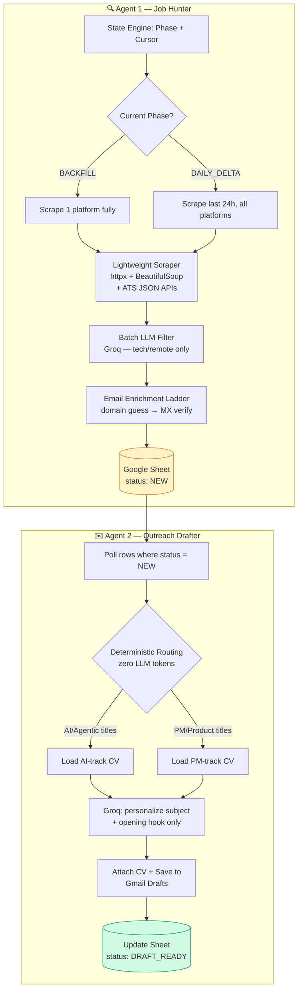

# 🎯 Personal Job Hunter Agent

<p align="center">
  
  
  
  
  
</p>

<p align="center">
  <strong>An autonomous, fail-closed multi-agent pipeline that hunts tech jobs, verifies company emails via DNS, and drafts personalized outreach — so you review and hit send, not write from scratch.</strong>
</p>

<p align="center">
  🌐 <a href="#-english">English</a> &nbsp;|&nbsp; 🇸🇦 <a href="#-العربية">العربية</a>
</p>

---

# 🌐 English

## 📖 Overview

Job hunting in tech is a full-time job on top of your full-time job search: dozens of boards to check daily, company emails hidden behind "Apply Now" buttons, and the mental tax of writing a fresh cover letter for every posting.

**Personal Job Hunter Agent** automates the repetitive 80% — discovery, filtering, email verification, and draft generation — while keeping you in control of the final 20% that matters: reviewing and sending.

It is built around three production-engineering principles that most "AI agent" scripts skip:

- **Fail-closed, not fail-silent.** A transient API error never gets mistaken for "no results found."
- **Idempotent by design.** Kill the process mid-run, restart it, and it resumes from the exact record it left off on — zero duplicates, zero lost work.
- **Evidence before action.** No company gets an email draft without a DNS-verified, real inbox behind it.

## ✨ Key Features

| Feature | What it does |
|---|---|
| 🕸️ **Deep Multi-Platform Discovery** | Scrapes general job boards (Wuzzuf, Bayt, Indeed) *and* queries ATS platforms (Greenhouse, Lever) directly via their public JSON APIs — far more reliable than HTML scraping |
| 🧠 **Two-Phase Time Machine** | Phase 1 runs a historical backfill (one platform per session); Phase 2 switches permanently to a 24-hour delta monitor — both states persisted in SQLite, resumable after any crash |
| 🎯 **Token-Efficient LLM Filtering** | Scraping uses zero LLM calls; Groq is only invoked in **batches** to classify and filter postings — built to survive free-tier rate limits with automatic model fallback |
| 📧 **Email Enrichment Ladder** | If no email is in the posting: extract company → resolve domain → generate smart guesses → **verify via DNS MX lookup** before accepting. No verified inbox = no silent guess ships |
| 🚦 **No-Email Fallback** | Companies with no verifiable email aren't dropped — they're logged with a `Manual Outreach Required` status, so no lead is silently lost |
| ✍️ **Zero-Token Deterministic Routing** | Job titles are routed to the matching track (e.g., AI vs. Product) via plain Python logic — no LLM spent deciding what's already obvious from a title string |
| 📝 **Personalized Draft Generation** | Each accepted lead gets a tailored subject line and opening hook (grounded in the actual job description) with the matching CV attached, saved straight to **Gmail Drafts** for your review |

## 🏗️ System Architecture

Two independently-running agents, decoupled through a Google Sheet as the single source of truth — if one fails, the other keeps working.



**Why decoupled?** Agent 1 and Agent 2 never call each other directly. The Sheet's status column is the only handoff point — so Agent 2 crashing never blocks Agent 1 from discovering new jobs, and vice versa.

## 🛠️ Tech Stack

| Layer | Tool | Why |
|---|---|---|
| Orchestration | Python 3.11+ | Async-friendly, mature ecosystem |
| LLM | Groq API (`openai/gpt-oss-120b` + fallback) | Free tier, fast inference, structured JSON output |
| Scraping | `httpx`, `BeautifulSoup4`, `duckduckgo-search` | Zero-cost, no headless browser overhead |
| State & Dedup | SQLite (WAL mode) | Single-file, zero-ops, crash-safe |
| Spreadsheet | Google Sheets API (`gspread`) | Free, shareable, human-reviewable source of truth |
| Email Drafts | Gmail API (OAuth2) | Native Drafts folder integration |
| Resilience | `tenacity` | Exponential backoff for 429/5xx errors |

## 🚀 Quick Start

```bash
# 1. Clone the repository
git clone https://github.com/<your-username>/personal-job-hunter-agent.git
cd personal-job-hunter-agent

# 2. Create an isolated virtual environment
python3 -m venv venv
source venv/bin/activate      # Windows: venv\Scripts\activate

# 3. Install dependencies
pip install -r requirements.txt

# 4. Configure your environment
cp .env.example .env
# Edit .env with your GROQ_API_KEY, GOOGLE_SERVICE_ACCOUNT_JSON,
# GOOGLE_SHEET_URL, and Gmail OAuth credentials

# 5. Customize your job titles and CV tracks
cp config/profile.example.json config/profile.json
# Edit profile.json: target job titles, CV file paths per track

# 6. Dry-run first — verify before anything touches your real Sheet or Gmail
DRY_RUN=true python -m src.runner
```

## ⚙️ How to Run & Automate

**One-off manual run:**
```bash
python -m src.runner
```

**Persistent background run (survives terminal close):**
```bash
nohup python -m src.scheduler > logs/agent.log 2>&1 &
```

**Check it's alive:**
```bash
tail -f logs/agent.log
```

**Stop it:**
```bash
pkill -f src.scheduler
```

> ⚠️ **Before running unattended**, read the [Ethical Use & Scraping Disclaimer](#️-ethical-use--scraping-disclaimer) below. You are responsible for complying with each platform's terms of service.

## ⚖️ Ethical Use & Scraping Disclaimer

This project is released for **personal, low-volume job search use** — not for building a commercial scraping service.

- It respects `robots.txt` and applies randomized delays between requests.
- It does **not** bypass authentication, CAPTCHAs, or paid-tier access controls.
- Email verification (DNS MX) confirms an inbox *can* receive mail — it does not grant permission to spam it. Use it for one-to-one, individually relevant job applications only.
- Running this against a platform's terms of service is **your responsibility**, not the maintainers'. Review each target platform's ToS before pointing this at it.

## 🤝 Contributing

Issues and PRs are welcome — especially new platform adapters (see `src/scrapers/`) and ATS integrations. Please open an issue before large architectural changes.

## 📄 License

MIT — use it, fork it, adapt it. See [LICENSE](LICENSE).

---

# 🇸🇦 العربية

## 📖 نظرة عامة

البحث عن وظيفة في مجال التقنية بقى وظيفة بدوام كامل فوق وظيفتك الأساسية: عشرات المنصات لازم تتابعها يومياً، إيميلات الشركات مخفية ورا زرار "Apply Now"، والعبء الذهني لكتابة Cover Letter جديد لكل إعلان.

**Personal Job Hunter Agent** بيؤتمت الـ 80% المتكررة من العملية — الاكتشاف، الفلترة، التحقق من الإيميلات، وتوليد المسودات — وبيسيبلك أنت الـ 20% الأهم: المراجعة والإرسال.

النظام مبني على ثلاث مبادئ هندسية إنتاجية بتفتقدها أغلب سكريبتات "AI Agents":

- **فشل صريح، مش فشل صامت.** أي خطأ API مؤقت مش هيتحسب غلط "مفيش نتائج".
- **ثابت (Idempotent) بالتصميم.** أوقف العملية في أي وقت، شغّلها تاني، هتكمل من آخر سجل اتعالج بالظبط — صفر تكرار، صفر فقدان بيانات.
- **دليل قبل أي إجراء.** مفيش شركة بتاخد مسودة إيميل بدون إيميل حقيقي اتأكد منه عبر DNS.

## ✨ المميزات الرئيسية

| الميزة | الوظيفة |
|---|---|
| 🕸️ **صيد عميق متعدد المنصات** | كشط منصات عامة (Wuzzuf, Bayt, Indeed) + استعلام مباشر لمنصات ATS (Greenhouse, Lever) عبر APIs عامة موثقة — أدق وأوثق من كشط HTML |
| 🧠 **آلة الزمن ثنائية المرحلة** | المرحلة الأولى: مسح تاريخي كامل (منصة واحدة لكل جلسة)، المرحلة الثانية: تحول دائم لفحص آخر 24 ساعة فقط — الحالتان محفوظتان في SQLite، قابلتان للاستئناف بعد أي انهيار |
| 🎯 **فلترة موفرة للتوكنز** | الكشط صفر استدعاءات LLM؛ Groq بيُستدعى فقط بدفعات للتصنيف — مصمم ليصمد تحت حدود الـ Free Tier مع تبديل موديل تلقائي |
| 📧 **سلّم إثراء الإيميلات** | لو مفيش إيميل في الإعلان: استخراج اسم الشركة ← حل الدومين ← تخمينات ذكية ← **تحقق عبر DNS MX** قبل القبول. مفيش إيميل مُتحقق منه = مفيش تخمين بيتبعت |
| 🚦 **خطة بديلة لغياب الإيميل** | الشركات بدون إيميل مُتحقق منه ما بتتجاهلش — بتتسجل بحالة `يحتاج تواصل يدوي`، فمفيش فرصة بتضيع بصمت |
| ✍️ **توجيه حتمي بدون توكنز** | المسميات الوظيفية بتتوجه للمسار المناسب (AI أو PM) بمنطق Python خالص — صفر استهلاك LLM لقرار واضح أصلاً من النص |
| 📝 **توليد مسودات مخصصة** | كل فرصة مقبولة بتاخد سطر موضوع وجملة افتتاحية مخصصة (مبنية على وصف الوظيفة الفعلي) مع السيرة الذاتية المناسبة مرفقة، محفوظة مباشرة في **Gmail Drafts** لمراجعتك |

## 🏗️ معمارية النظام

وكيلان مستقلان تماماً، مرتبطان فقط عبر Google Sheet كمصدر حقيقة وحيد — لو واحد وقع، التاني يكمل شغله عادي.

*(نفس مخطط Mermaid أعلاه — المعمارية واحدة بغض النظر عن اللغة)*

**ليه منفصلين؟** الوكيل الأول والثاني ما بيستدعوش بعض مباشرة أبداً. عمود الحالة في الشيت هو نقطة التسليم الوحيدة — فانهيار الوكيل الثاني مايوقفش اكتشاف وظائف جديدة من الأول، والعكس صحيح.

## 🛠️ الأدوات التقنية

| الطبقة | الأداة | السبب |
|---|---|---|
| التنسيق | Python 3.11+ | نضج المكتبات ودعم Async |
| الـ LLM | Groq API (`openai/gpt-oss-120b` + احتياطي) | مجاني، سريع، إخراج JSON منظم |
| الكشط | `httpx`, `BeautifulSoup4`, `duckduckgo-search` | صفر تكلفة، بدون عبء متصفح headless |
| الحالة والتكرار | SQLite (وضع WAL) | ملف واحد، صفر عمليات تشغيلية، آمن ضد الانهيار |
| الجداول | Google Sheets API (`gspread`) | مجاني، قابل للمشاركة، مصدر حقيقة قابل للمراجعة البشرية |
| مسودات الإيميل | Gmail API (OAuth2) | تكامل أصلي مع مجلد Drafts |
| الصمود | `tenacity` | تراجع أُسّي لأخطاء 429/5xx |

## 🚀 دليل التشغيل السريع

```bash
# 1. استنساخ المستودع
git clone https://github.com/<your-username>/personal-job-hunter-agent.git
cd personal-job-hunter-agent

# 2. إنشاء بيئة افتراضية معزولة
python3 -m venv venv
source venv/bin/activate      # ويندوز: venv\Scripts\activate

# 3. تثبيت المتطلبات
pip install -r requirements.txt

# 4. إعداد متغيرات البيئة
cp .env.example .env
# عدّل .env بمفتاح GROQ_API_KEY وملف خدمة جوجل ورابط الشيت وبيانات OAuth

# 5. تخصيص المسميات الوظيفية والسير الذاتية
cp config/profile.example.json config/profile.json
# عدّل profile.json: المسميات المستهدفة، مسارات ملفات CV لكل مسار

# 6. شغّل تجربة Dry-Run الأول — تحقق قبل ما تلمس شيتك أو Gmail الحقيقي
DRY_RUN=true python -m src.runner
```

## ⚙️ التشغيل اليدوي والمستمر

**تشغيل يدوي لمرة واحدة:**
```bash
python -m src.runner
```

**تشغيل مستمر في الخلفية (يستمر بعد إغلاق التيرمنال):**
```bash
nohup python -m src.scheduler > logs/agent.log 2>&1 &
```

**التأكد إنه شغّال:**
```bash
tail -f logs/agent.log
```

**الإيقاف:**
```bash
pkill -f src.scheduler
```

> ⚠️ **قبل التشغيل بدون مراقبة**، اقرأ قسم [الاستخدام الأخلاقي وإخلاء المسؤولية](#️-الاستخدام-الأخلاقي-وإخلاء-المسؤولية) تحت. أنت المسؤول عن الالتزام بشروط استخدام كل منصة.

## ⚖️ الاستخدام الأخلاقي وإخلاء المسؤولية

هذا المشروع مُتاح **للاستخدام الشخصي منخفض الحجم في البحث عن وظيفة** — مش لبناء خدمة كشط تجارية.

- يحترم `robots.txt` ويطبّق تأخيرات عشوائية بين الطلبات.
- **لا يتجاوز** أنظمة المصادقة أو الـ CAPTCHA أو حماية المحتوى المدفوع.
- التحقق من الإيميل عبر DNS MX بيأكد إن الصندوق **قادر على الاستقبال** — ده مش إذن لإرسال رسائل جماعية. استخدمه فقط لتقديمات وظيفية فردية ذات صلة حقيقية.
- تشغيل هذا الكود بما يخالف شروط استخدام أي منصة هو **مسؤوليتك أنت**، مش مسؤولية القائمين على المشروع. راجع شروط كل منصة قبل توجيه الأداة إليها.

## 🤝 المساهمة

الإسهامات والـ Pull Requests مرحّب بيها — خصوصاً إضافة منصات جديدة (`src/scrapers/`) وتكاملات ATS إضافية. افتح Issue قبل أي تعديل معماري كبير.

## 📄 الرخصة

MIT — استخدمه، انسخه، عدّله. راجع ملف [LICENSE](LICENSE).
